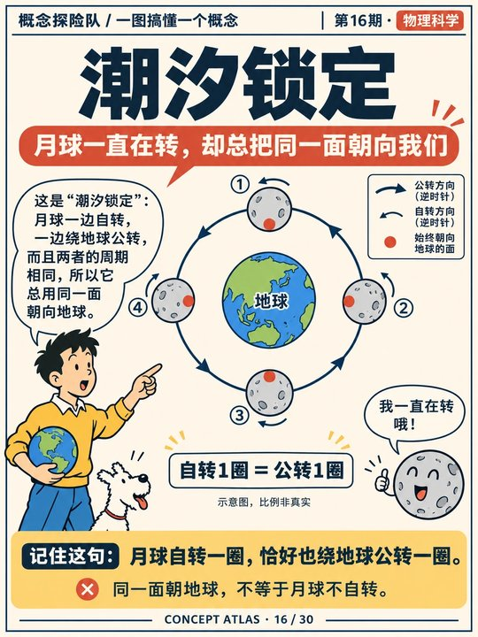

<p align="right"><a href="README.md">中文</a></p>

<p align="center">
  
</p>

<p align="center">
  <a href="https://xiaosang.cc/concept-atlas/">▶ View Online</a>
  ·
  <a href="https://github.com/holynova/concept-atlas">GitHub Repository</a>
</p>

121 illustrated explainers for familiar words with unfamiliar mechanics — offside, tidal locking, compound interest, focal length, and more. One concept per poster, 3:4 portrait, Tintin-style ligne claire art, with category filters, search, full-resolution reading, copyable text, and original PNG downloads.

## Screenshots

<p align="center">
  
  
</p>

## Contents

- **121 comics, 9 fields**: 体育运动 Sports (21), 心理与生活 Mind & Life (21), 电影摄影 Film & Photography (17), 物理科学 Physics & Science (11), 自然与旅行 Nature & Travel (11), 金融经济 Finance & Economics (10), 出行交通 Transport (10), 居家与饮食 Home & Food (10), 影音与错觉 Audio-Visual & Illusions (10).
- **Every poster's structure**: a one-line hook (one sentence that cracks the key idea) + a central diagram (position, sequence, direction, or causality) + a 「记住这句」 ("Remember this") one-line takeaway + one common-misconception note.
- **Every poster has sources**: the copy links to real primary sources (e.g. the IFAB offside rules in the original), and `source/manifest-*.json` keeps the copy, sources and production prompts.
- **10 more posters are archived, not published**: computer-engineering topics (nos. 21–25, 51–55) are held back from the public gallery; originals and copy stay in the repo archive.

## Features

- **Filter by category, search by keyword**: filter across the 9 fields, or search by concept name, explanation or keyword.
- **随便看看 (Surprise me)**: draw a random poster.
- **Read it large**: tap any poster for a full-resolution image, portrait-friendly.
- **Copy the text**: each poster's explanation copies with one click.
- **Download originals**: download a single original PNG, or the whole set in one pack (~215 MB).

## Run Locally

A static site — just serve it (`dist/` is the published content):

```bash
npm run dev
# Open http://localhost:4317
```

Regenerate derivatives (thumbnails / reading images, Python + Pillow):

```bash
npm run build
```

## Tech

- No build step, no framework: `dist/` is a plain HTML + CSS + JS static site, with data in `dist/concepts.json` (121 entries).
- Images in three tiers: original PNGs (`dist/assets/posters/`, ~226 MB total) + reading WebP (`dist/assets/detail/`) + list thumbnails (`dist/assets/thumbs/`), 121 each.
- Art direction is pinned in `source/ART-DIRECTION.md`: warm paper background #FFF7E7, dark-blue ink #17324A, flat fills, no gradients, no watercolor; the leads are an original boy explorer and his little white dog.

```
dist/                     Published content (the static site itself)
dist/concepts.json        121 concept entries: hook, explanation, misconception, tags, sources
dist/assets/posters/      121 original PNG posters (3:4 portrait)
dist/assets/detail/       121 reading WebP images
dist/assets/thumbs/       121 list thumbnails
source/manifest-*.json    Per-poster copy, sources and production prompts
source/ART-DIRECTION.md   Art style and layout conventions
```
