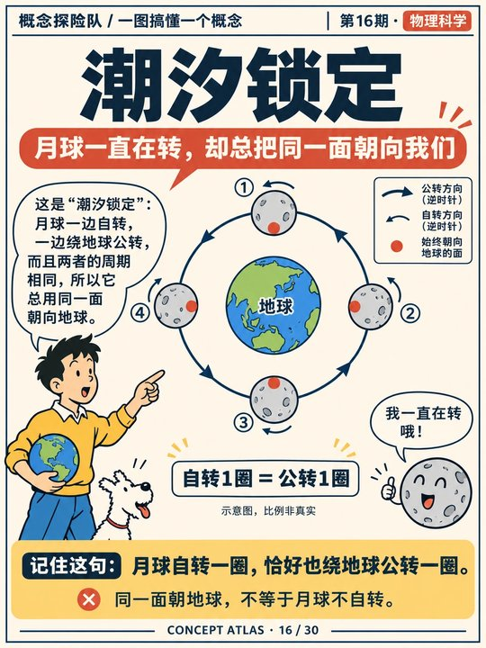

<p align="right"><a href="README.en.md">English</a></p>

<p align="center">
  
</p>

<p align="center">
  <a href="https://xiaosang.cc/concept-atlas/">▶ 在线浏览</a>
  ·
  <a href="https://github.com/holynova/concept-atlas">GitHub 仓库</a>
</p>

用 121 张清晰线描漫画解释那些字都认识、机制却难懂的概念：足球越位、潮汐锁定、复利、镜头焦段……每张一个概念，3:4 竖版，丁丁历险记式 ligne claire 画风，支持分类搜索、放大阅读、文案复制与原图打包下载。

## 截图

<p align="center">
  
  
</p>

## 内容

- **121 张漫画，9 个领域**：体育运动 21、心理与生活 21、电影摄影 17、物理科学 11、自然与旅行 11、金融经济 10、出行交通 10、居家与饮食 10、影音与错觉 10。
- **每张的结构**：一句钩子（一句话点破关键）+ 中央图解（位置、顺序、方向或因果）+「记住这句」一句话结论 + 一个常见误区提醒。
- **每张都有来源**：文案附真实一手来源链接（如 IFAB 越位规则原文），`source/manifest-*.json` 保存文案、来源与制作提示词。
- **另有 10 张未公开**：偏工程实现的计算机技术选题（编号 21–25、51–55）暂从公开画廊收起，原图与文案仍保存在仓库归档。

## 功能

- **分类筛选与搜索**：按 9 个领域过滤，按概念名、解释或关键词搜索。
- **随便看看**：随机抽一张。
- **放大阅读**：点任意一张看全分辨率大图，竖屏友好。
- **文案复制**：每张的讲解文字可一键复制。
- **原图下载**：单张下载原始 PNG，或一键打包下载全部（约 215 MB）。

## 本地运行

静态站，直接起一个静态服务器即可（`dist/` 就是发布内容）：

```bash
npm run dev
# 打开 http://localhost:4317
```

重新生成衍生图（缩略图 / 阅读图，Python + Pillow）：

```bash
npm run build
```

## 技术

- 零构建、零框架：`dist/` 是纯 HTML + CSS + JS 静态站，数据是 `dist/concepts.json`（121 条）。
- 图片三级：原始 PNG（`dist/assets/posters/`，共约 226 MB）+ 阅读 WebP（`dist/assets/detail/`）+ 列表缩略图（`dist/assets/thumbs/`），各 121 张。
- 画风按 `source/ART-DIRECTION.md` 约定：暖纸底 #FFF7E7、藏青墨 #17324A、扁平填色、无渐变无水彩；主角是原创少年探险家与小白狗。

```
dist/                     发布内容（静态站本体）
dist/concepts.json        121 条概念数据：钩子、讲解、误区、标签、来源
dist/assets/posters/      121 张原始 PNG 海报（3:4 竖版）
dist/assets/detail/       121 张阅读用 WebP
dist/assets/thumbs/       121 张列表缩略图
source/manifest-*.json    每张的文案、来源与制作提示词
source/ART-DIRECTION.md   画风与版式约定
```
